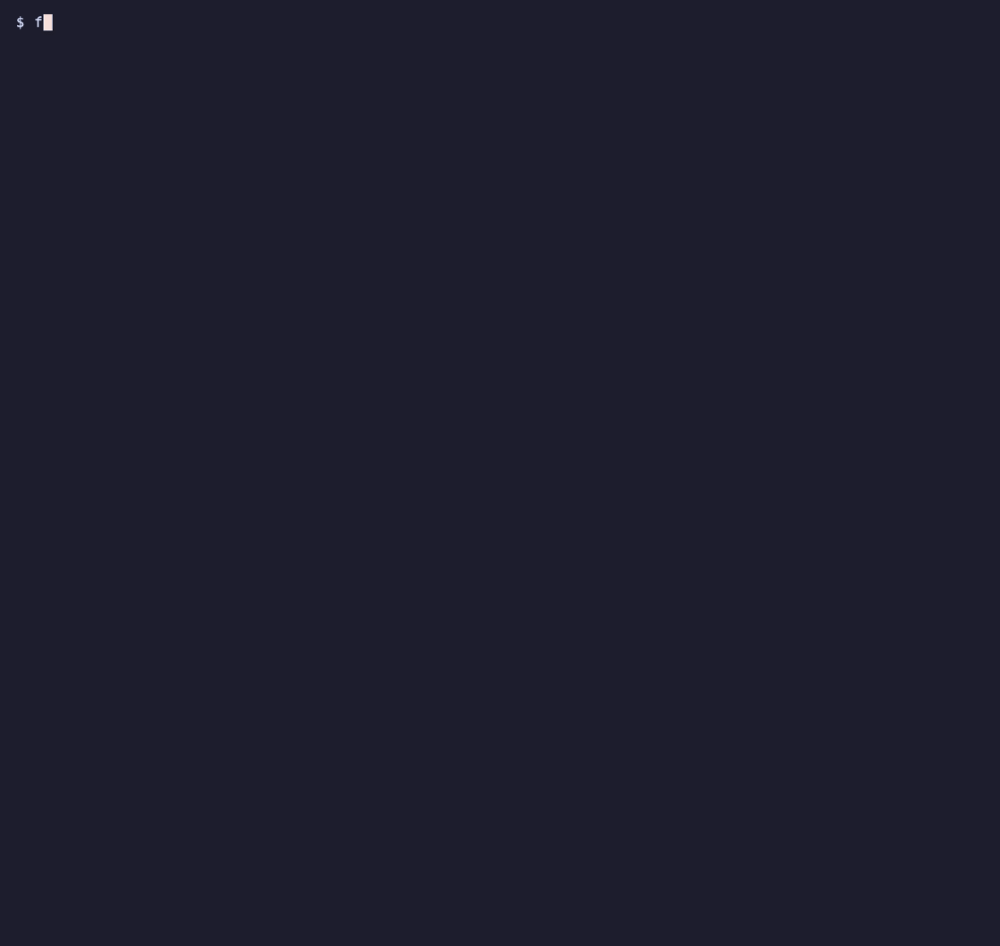

# feedtick

Get only the RSS headlines you have not confirmed yet, grouped by sector with source timestamps.

[](https://github.com/itzjk/feedtick/actions/workflows/ci.yml)
[](LICENSE)



## Quick start

Requires Python 3.11+ and [pipx](https://pipx.pypa.io/).

```sh
pipx install git+https://github.com/itzjk/feedtick.git
```

```sh
feedtick demo
```

The demo starts a local RSS server, confirms a first batch, adds one headline, and checks again. The second batch contains only that headline. It then takes one source offline to show partial coverage. Everything uses temporary state and synthetic headlines.

## Features

- See new headlines by your own sectors, without rereading a daily digest.
- Retry a saved batch until you explicitly confirm its ID.
- Distinguish publication time from when your machine first saw an entry.
- Keep links and dates in text, Markdown, or JSON output.
- See source failures alongside results from sources that worked.

## Why

[GrainStats](https://x.com/GrainStats/status/2115493425449677098) asked why grain newsletters wait for the close, while [Foshograin](https://x.com/Foshograin/status/2115580610525708445) asked for brief, hourly headlines separated by sector. These are small, specific signals, rather than evidence of a large market or willingness to pay; this workflow has not been tested with those authors. feedtick tests a narrower idea: a local, confirmed delta can reduce repeated checking without accounts, an aggregator server, or model tokens.

## How it works

`check` fetches your configured feeds and saves an immutable batch in SQLite. A repeated check returns that batch without polling, even if you edit the configuration. `ack` confirms exactly its entries; it does not claim anyone read or received them. The next check polls again. Publication dates within the previous 24 hours are labeled recent; older discoveries, missing dates, invalid dates, and future dates have separate labels. All times are UTC, and the recent window is configurable.

## Usage

Create `feeds.toml` with explicit sectors and optional display names:

```toml
[[feeds]]
url = "https://www.graincentral.com/news/feed"
sector = "Grains"
name = "Grain Central News"

[[feeds]]
url = "https://www.graincentral.com/trade/feed"
sector = "Trade"
name = "Grain Central Trade"
```

[Grain Central lists these feeds](https://www.graincentral.com/rss-feeds/). Their availability and publishing delay depend on the publisher.

| Command or option | Purpose |
| --- | --- |
| `feedtick check feeds.toml` | Fetch headlines or repeat the pending batch |
| `feedtick ack <batch-id>` | Confirm the exact batch ID printed by check |
| `--json` / `--markdown` | Choose a check output format |
| `--state path.sqlite3` | Select the same state file for check and ack |
| `--timeout 10 --retries 1` | Bound download attempts; retries allow 0 to 2 |
| `--recent-hours 24` | Set the publication freshness window |

State defaults to `$XDG_STATE_HOME/feedtick/state.sqlite3`, or `~/.local/state/feedtick/state.sqlite3`. `FEEDTICK_STATE` sets another default. One state file has one pending batch. Independent review queues need separate state files.

## FAQ

**Does it support Atom?** Yes, alongside well-formed RSS. It fetches feed endpoints and follows their HTTP redirects, never article links.

**What happens if a title changes?** The entry stays confirmed when its identity stays the same. Pending output stays frozen. Stable IDs are scoped to their source; missing or reused IDs fall back to normalized links. Equivalent links across sources appear once with provenance. Different titles alone never merge entries. See [identity and recovery](docs/behavior.md).

**Can I schedule it?** Yes. [The cron example](docs/behavior.md#scheduling) saves output without confirming it. Review and acknowledge the printed ID yourself.

**How is this different from other readers?** [Newsboat](https://newsboat.org/) is a full terminal reader; [rss-digest](https://github.com/edsu/rss-digest) summarizes aggregator articles with a model; [Daily Signal Digest](https://github.com/DonghaoxiangOscar/Daily-Signal-Digest) builds a time-window digest. feedtick centers on replayable batches and explicit confirmation. See the [workflow comparison](docs/alternatives.md).

## Limitations

- RSS is publisher-delayed, not a real-time news guarantee. Entries that rotate out before a poll can be missed, including while a batch waits for confirmation.
- First run includes the feed's available backlog. Source dates are claims, not verified event times.
- XML is limited to 2 MiB, 30,000 nodes, and depth 64. DTDs and entities are rejected. Compressed responses are rejected; servers must honor identity encoding.
- Exit code `2` means partial coverage, even when there are no headlines. `1` means a command or state error. Successful checks and confirmations return `0`.
- No SMS, email, summaries, relevance scoring, or market recommendations.

## Contributing

From a clone, install with `python -m pip install -e '.[test]'` and run `python -m pytest -q`; tests use synthetic local HTTP feeds.

## License

[MIT](LICENSE).
